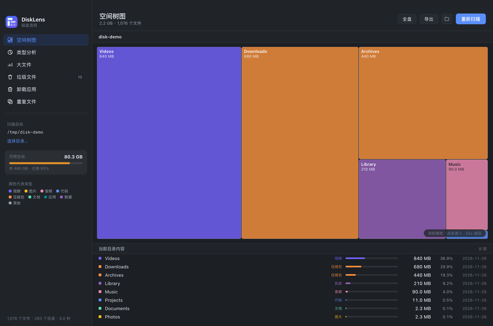
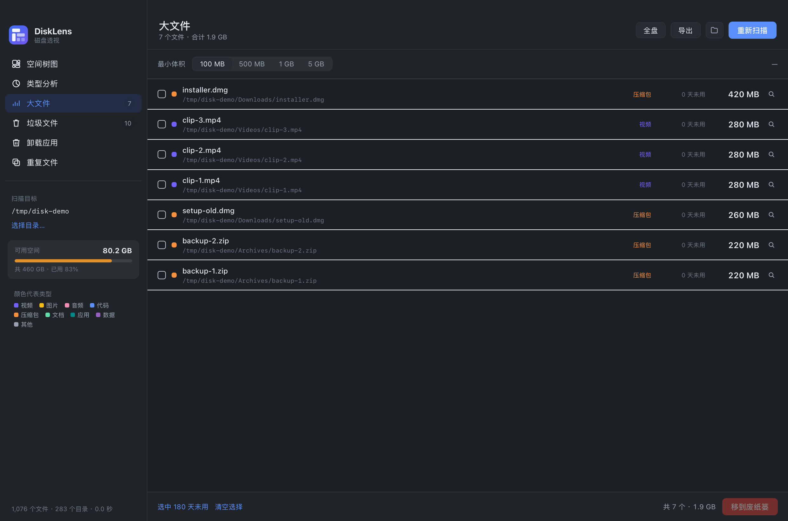
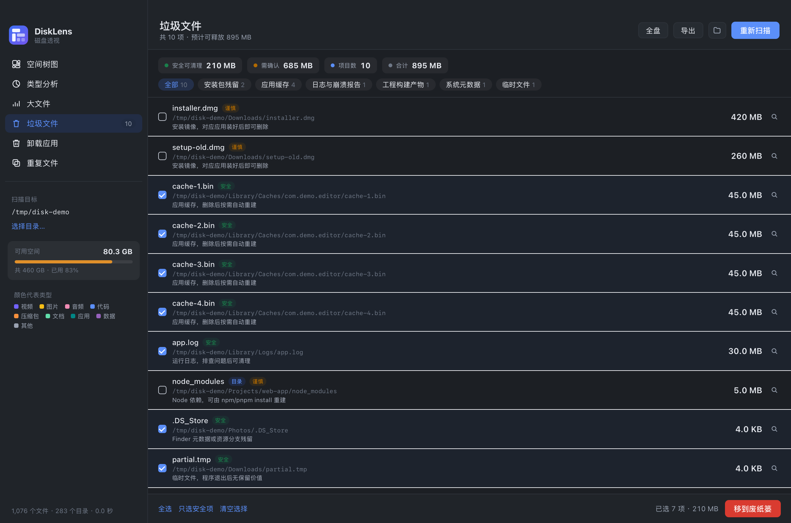
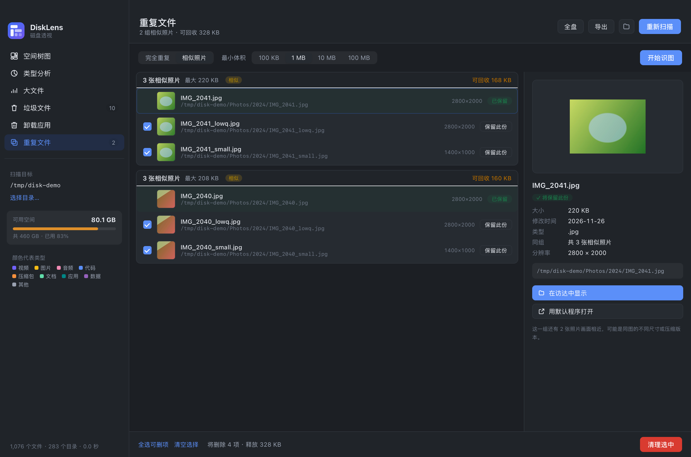
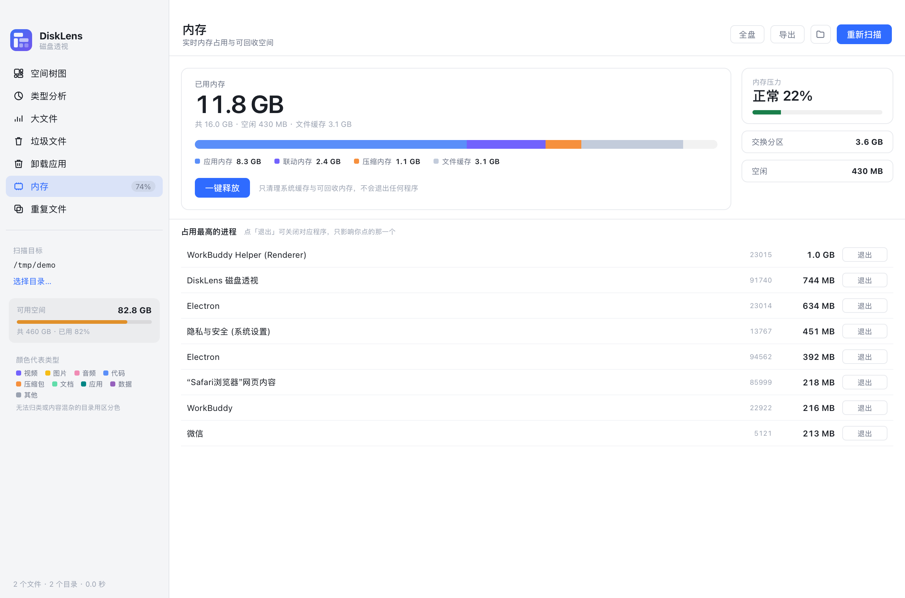
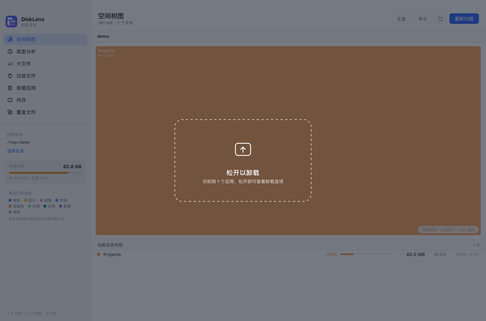

# DiskLens · 磁盘透视

一个原生 macOS 磁盘分析工具。用矩形树图看清每个文件夹到底占了多少空间，顺手清掉垃圾、重复照片和不再用的应用。

**完全本地运行，不联网，不上传任何数据。**



## 功能

| 模块 | 能做什么 |
|---|---|
| **空间树图** | WizTree 式矩形树图，面积即占用，颜色代表文件类型。点击或滚轮下钻，面包屑返回 |
| **类型分析** | 按文件类型或**按应用**聚合。一眼看出「哪个 App 吃了多少盘」 |
| **大文件** | 按体积筛选，标注 **180 天未使用**的冷数据，可批量选中清理 |
| **垃圾文件** | 识别缓存、日志、崩溃报告、临时文件、安装包残留、工程构建产物，分「安全」「谨慎」两级 |
| **卸载应用** | 列出已安装应用，按 bundle id 匹配 17 类残留路径；也可直接把 .app 拖进窗口卸载；可按占用空间、最近使用、安装时间、名称排序 |
| **重复文件** | 按内容哈希查重，识别硬链接（删除不释放空间的情况会标出来） |
| **内存** | 实时显示应用内存、联动内存、压缩内存与文件缓存，一键释放可回收部分，并列出占用最高的进程 |
| **相似照片** | 256 位感知哈希 + 平均色校验，找出同一张图的不同尺寸、不同压缩版本 |

所有删除操作都走系统废纸篓，删除前有确认框，`/System`、`/usr` 等系统路径硬性拒绝。

各列表都支持排序：应用可按**占用空间 / 最近使用 / 安装时间 / 名称**，垃圾文件可按**大小 / 名称 / 类别 / 风险**，重复文件可按**可回收空间 / 单个大小 / 文件数 / 名称**，每组都有正序与反序切换。

## 内存清理

分为四段可视化：应用内存、联动内存（wired）、压缩内存、文件缓存，并给出内存压力与交换分区占用。

点「一键释放」会调用系统的 `purge` 清理文件缓存与可回收页，**不会退出任何程序**。这一步需要管理员授权——macOS 只允许 root 执行 `purge`，所以会弹出一次系统密码框，取消则不做任何操作。释放量以操作前后的实际占用差值计算，缓存本来就干净时会如实显示「没有可释放的空间」。

下方的进程列表按占用排序，可以逐个退出其中某个程序；按钮需要点两次确认，且只影响你点的那一个进程。

## 拖拽卸载

把「应用程序」里的任意 `.app` 拖到窗口内，界面会出现虚线投放区；松开后自动切到卸载页并定位到该应用，列出它的残留文件。

- 一次只处理一个应用，多选时会提示并取第一个
- 拖入的不是 `.app`（例如普通文件或文件夹）会明确提示，不做任何操作
- 应用不在 `/Applications` 也能识别，拖入后会临时加入列表
- 正在运行的应用会在详情里标注，建议先退出再卸载

卸载时只会删除该应用本体与**你勾选**的残留，不会触碰其它程序。

## 界面

| 类型分析 | 大文件 |
|---|---|
|  |  |

| 垃圾文件 | 相似照片 |
|---|---|
|  |  |

| 内存 | 拖拽卸载 |
|---|---|
|  |  |

> 截图使用一份公开的示例数据（`/tmp/disk-demo`），不含任何个人文件。

## 安装

从 [Releases](https://github.com/BILSON093/disklens/releases/latest) 下载 `DiskLens.app`，拖进「应用程序」即可。

首次打开若被 Gatekeeper 拦下，右键 →「打开」，或在终端执行：

```bash
xattr -dr com.apple.quarantine /Applications/DiskLens.app
```

## 从源码构建

需要 macOS 14+、Apple Silicon，以及 Xcode Command Line Tools（`xcode-select --install`）。

```bash
./build.sh            # 只构建到 build/DiskLens.app
./build.sh --install  # 构建并安装到 /Applications
```

没有第三方依赖，也不需要 Xcode 工程文件——`build.sh` 直接调 `swiftc` 编译源码、生成图标、打 `.app` 包并做 ad-hoc 签名。

## 权限说明

扫描自己的用户目录（`~/Library` 除外的一部分）不需要授权。要完整读取 `~/Library`、`/Library`、其他用户目录或全盘，需要在
**系统设置 → 隐私与安全性 → 完全磁盘访问权限** 里勾选 DiskLens。

应用会在扫描后自检授权是否真正生效，并在顶部明确区分两种情况：

- **「完全磁盘访问尚未生效」**：说明还有目录读不到，点击「查看目录」能看到具体是哪些
- **「有 N 个系统级目录受保护」**：授权已生效，剩余无法读取的是 `/private/var/db` 这类需要 root 的路径，属正常现象

> ⚠️ 自行编译时注意：`build.sh` 使用 **ad-hoc 签名**，每次重新编译 cdhash 都会变，macOS 会把它当成新程序，之前的授权随之失效。遇到这种情况，在设置里把 DiskLens 移除再重新添加即可。Releases 里的正式构建不会变，授权一次长期有效。

## 一些实现说明

- **扫描内核**：单次 `lstat` 取全部属性（大小/块数/时间/inode），顶层与浅层目录并行。用户目录约 150 万文件 40 秒，全盘约 195 万文件 60 秒。
- **全盘扫描会跳过** `/.nofollow`、`/.resolve`、`/System/Volumes`、`/Volumes`。前两个是 firmlink 绕行命名空间（整套文件系统的影子副本，不跳过会让文件数虚增三倍），后两个是数据卷副本与启动快照。因此全盘结果会略小于「已用空间」，差值主要是 APFS 快照与系统卷。
- **硬链接**：查重按 `(device, inode)` 归并，可回收空间按真实 inode 数计算，不会把「删了也不省空间」的路径算进去。
- **相似照片**：16×16 差值哈希（256 位）配合平均 RGB 校验，过滤「灰度结构相同但颜色完全不同」的误判。
- **结果缓存**：每次扫描会把树的前 5 层、类型/应用聚合、垃圾清单存到
  `~/Library/Application Support/DiskLens/last-scan.json`，下次打开直接回放并显示扫描时间，不必重扫。

## 常见问题

**开启了完全磁盘访问，界面仍提示「尚未生效」？**
系统按二进制哈希记录授权，自行编译后哈希变化会被当成新程序。在设置里把 DiskLens 移除再重新添加即可；Releases 中的构建是固定的，授权一次长期有效。

**全盘扫描的总量比「已用空间」少几十 GB？**
全盘会跳过 `/.nofollow`、`/.resolve`、`/System/Volumes`、`/Volumes`（firmlink 影子副本与系统快照），差值主要是 APFS 本地快照和系统卷。侧栏的磁盘占用条读的是文件系统真实数值。

**内存清理为什么要输密码？**
`purge` 是系统命令，只允许 root 执行，macOS 无法以普通权限调用。取消授权不会做任何改动。

**为什么有些目录始终读不到？**
`/private/var/db`、`/var/root` 这类路径即使拥有完全磁盘访问也需要 root 权限，属正常现象。点提示里的「查看目录」可以看到具体清单。

**上次的扫描结果存在哪、会不会过期？**
存在 `~/Library/Application Support/DiskLens/last-scan.json`，保存树的前 5 层与聚合数据。目录被删除或移动后缓存会自动作废。深层目录、重复文件与相似照片仍需重新扫描。

## 开发与调试

除了 GUI，应用内置了几个命令行入口，便于验证和排查：

```bash
./build/DiskLens.app/Contents/MacOS/DiskLens --scanonly <目录>   # 只跑扫描内核，打印统计
./build/DiskLens.app/Contents/MacOS/DiskLens --apps             # 列出已安装应用与残留
./build/DiskLens.app/Contents/MacOS/DiskLens --trash <路径,...>  # 测试删除链路
./build/DiskLens.app/Contents/MacOS/DiskLens --hittest <x,y>    # 查看某坐标命中的视图
```

环境变量 `DL_AUTOCONFIRM=1` 可跳过删除确认框，`DL_DEBUG_SNAP=1` 打印快照读写日志。

## 已知限制

- 全盘扫描不含系统卷与 APFS 本地快照，实际可用空间请看侧栏的磁盘占用条。
- 相似照片对**剧烈裁切**或旋转的同一张图可能漏检（差值哈希对裁剪敏感）。
- 缓存只保留 5 层目录，更深层级需要重新扫描；重复文件与相似照片始终需要实时计算。
- 界面层用 WKWebView 渲染（原生扫描内核 + 网页 UI），包体约 1.9 MB。

## 许可

[MIT](LICENSE) © 2026 DiskLens Contributors
