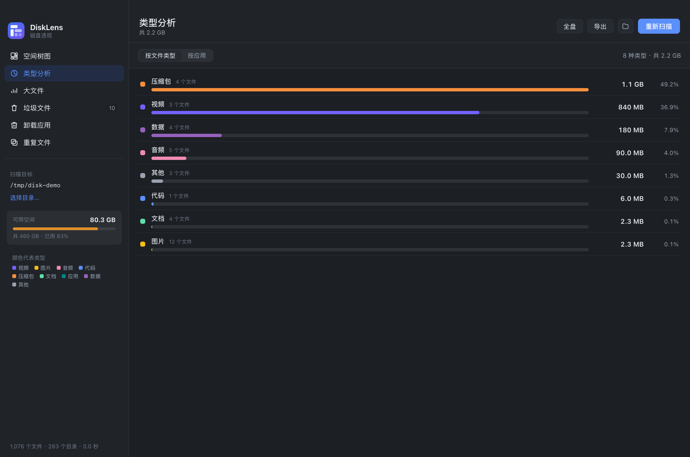

# DiskLens · 磁盘透视

一个原生 macOS 磁盘分析工具。用矩形树图看清每个文件夹到底占了多少空间，顺手清掉垃圾、重复照片和不再用的应用。

**完全本地运行，不联网，不上传任何数据。**


## 功能

| 模块 | 能做什么 |
|---|---|
| **空间树图** | WizTree 式矩形树图，面积即占用，颜色代表文件类型。点击或滚轮下钻，面包屑返回 |
| **类型分析** | 按文件类型或**按应用**聚合。一眼看出「哪个 App 吃了多少盘」 |
| **大文件** | 按体积筛选，标注 **180 天未使用**的冷数据，可批量选中清理 |
| **垃圾文件** | 识别缓存、日志、崩溃报告、临时文件、安装包残留、工程构建产物，分「安全」「谨慎」两级 |
| **卸载应用** | 列出已安装应用，按 bundle id 匹配 17 类残留路径，App 本体与残留一起清理 |
| **重复文件** | 按内容哈希查重，识别硬链接（删除不释放空间的情况会标出来） |
| **相似照片** | 256 位感知哈希 + 平均色校验，找出同一张图的不同尺寸、不同压缩版本 |

所有删除操作都走系统废纸篓，删除前有确认框，`/System`、`/usr` 等系统路径硬性拒绝。

## 界面

| 类型分析 | 大文件 |
|---|---|
|  |  |

| 垃圾文件 | 相似照片 |
|---|---|
|  |  |

> 截图使用一份公开的示例数据（`/tmp/disk-demo`），不含任何个人文件。

## 安装

从 [Releases](https://github.com/BILSON093/disklens/releases/latest) 下载 `DiskLens.app`，拖进「应用程序」即可。

首次打开若被 Gatekeeper 拦下，右键 →「打开」，或在终端执行：

```bash
xattr -dr com.apple.quarantine /Applications/DiskLens.app
```

## 从源码构建

需要 macOS 14+、Apple Silicon，以及 Xcode Command Line Tools（`xcode-select --install`）。

```bash
./build.sh            # 只构建到 build/DiskLens.app
./build.sh --install  # 构建并安装到 /Applications
```

没有第三方依赖，也不需要 Xcode 工程文件——`build.sh` 直接调 `swiftc` 编译源码、生成图标、打 `.app` 包并做 ad-hoc 签名。

## 权限说明

扫描自己的用户目录不需要任何授权。要扫 `/Library`、其他用户目录或全盘，需要在
**系统设置 → 隐私与安全性 → 完全磁盘访问权限** 里勾选 DiskLens。没有授权时顶部会提示跳过了多少个目录，不会静默给出偏小的结果。

## 一些实现说明

- **扫描内核**：单次 `lstat` 取全部属性（大小/块数/时间/inode），顶层与浅层目录并行。用户目录约 150 万文件 40 秒，全盘约 195 万文件 60 秒。
- **全盘扫描会跳过** `/.nofollow`、`/.resolve`、`/System/Volumes`、`/Volumes`。前两个是 firmlink 绕行命名空间（整套文件系统的影子副本，不跳过会让文件数虚增三倍），后两个是数据卷副本与启动快照。因此全盘结果会略小于「已用空间」，差值主要是 APFS 快照与系统卷。
- **硬链接**：查重按 `(device, inode)` 归并，可回收空间按真实 inode 数计算，不会把「删了也不省空间」的路径算进去。
- **相似照片**：16×16 差值哈希（256 位）配合平均 RGB 校验，过滤「灰度结构相同但颜色完全不同」的误判。
- **结果缓存**：每次扫描会把树的前 5 层、类型/应用聚合、垃圾清单存到
  `~/Library/Application Support/DiskLens/last-scan.json`，下次打开直接回放并显示扫描时间，不必重扫。

## 已知限制

- 全盘扫描不含系统卷与 APFS 本地快照，实际可用空间请看侧栏的磁盘占用条。
- 相似照片对**剧烈裁切**或旋转的同一张图可能漏检（差值哈希对裁剪敏感）。
- 缓存只保留 5 层目录，更深层级需要重新扫描；重复文件与相似照片始终需要实时计算。
- 界面层用 WKWebView 渲染（原生扫描内核 + 网页 UI），包体约 1.9 MB。

## 许可

[MIT](LICENSE) © 2026 DiskLens Contributors
